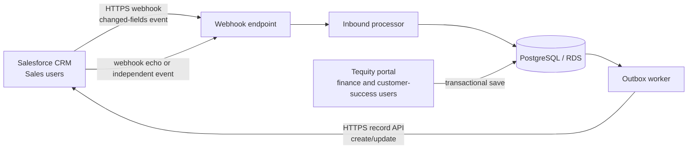

# Two-way Salesforce–Portal Synchronization Design

## 1. Assumptions and questions

### Confirmed requirements

- Salesforce is the existing CRM; the Tequity portal and its PostgreSQL database are ours to design.
- Customers and contacts are synchronized in both directions.
- Production contains approximately 5 million combined customer and contact records.
- Salesforce calls our HTTPS webhook for Salesforce-side changes.
- The portal calls Salesforce's official create/update record API for portal-side changes.
- While both systems are available, a change is visible on the other side within 30 seconds.
- Webhooks can be duplicated and delivered out of order.
- Earlier values, actors, and timestamps remain auditable.
- The Salesforce API permits at most 100 requests/second, including retries.
- Salesforce may be unreachable for six hours; durable pending work must survive our restart.
- Deletes, login screens, UI, a second region, and real-Salesforce load testing are out of scope.

### Adopted assumptions

- Sustained peak is 20 logical edits/second; quiet-hour baseline is 2 edits/second.
- We operate Salesforce calls at 80 requests/second, leaving headroom below the 100-request cap.
- A logical edit can contain multiple changed fields and normally maps to one Salesforce API request.
- Webhooks contain changed fields only. `changedFields` is authoritative for the fields affected by an event.
- Portal ordering uses a server-assigned monotonic commit sequence, with server time retained for audit.
- Same-field portal conflicts use optimistic, field-level concurrency. A stale save returns a conflict instead of silently overwriting.
- Different-field edits merge.
- Portal-originated mutations carry correlation and idempotency metadata where Salesforce supports it.
- SQLite through Sequelize is the local demonstration database. PostgreSQL on RDS is the production target.
- One worker can be demonstrated locally; production workers claim batches using PostgreSQL row locks.

### Open questions

- Does Salesforce provide a replayable change feed, replay ID, or reliable `ModifiedSince` query?
- Does Salesforce preserve our correlation or idempotency key in a resulting webhook?
- Does its API provide record versions or conditional updates?
- Are event IDs stable across redelivery and globally unique?
- Is `occurredAt` authoritative enough when no provider sequence exists?
- How are portal-created records assigned Salesforce IDs?
- What are the retry-after semantics and permanent-error categories?
- What audit retention and privacy rules apply?
- Is initial backfill of 5 million records already available?
- Are relationship changes, such as moving a contact to another customer, handled as ordinary field changes?

If Salesforce cannot replay or query changes made while its webhooks were unavailable, Salesforce-side convergence after an outage cannot be guaranteed automatically. The portal outbox does not solve that reverse-direction gap.

## 2. Systems, callers, network boundary, and interfaces



The only network path between systems is HTTPS over the public internet. Users talk to their own application only: sales users use Salesforce; portal users use the portal.

The webhook endpoint validates authentication, schema, object type, event identity, and fields before applying the event. It hands validated events to the inbound processor through the same durable database transaction boundary; no unvalidated payload is stored as business state.

The portal writes current state, field metadata, audit history, and an outbound command in one local transaction. The worker performs remote Salesforce calls outside the database transaction, then records the result in a short follow-up transaction.

## 3. Subproblems and build order

1. Establish stable record identity and field ownership.
2. Define event, mutation, correlation, and version metadata.
3. Implement durable current state and append-only history.
4. Implement inbound validation, deduplication, ordering, and field application.
5. Implement portal optimistic concurrency and atomic outbox creation.
6. Implement loop classification and suppression of outbound propagation for inbound events.
7. Implement rate-limited retries, leases, and restart recovery.
8. Define Salesforce outage reconciliation and its explicit capability limitation.
9. Add operational metrics and alert thresholds.
10. Validate duplicate, stale, loop, and restart/outage scenarios with a fake CRM.

The risky ordering and durability decisions come before service decomposition because they determine the required database state and component boundaries.

## 4. Data stored

The demo uses Sequelize models over SQLite. Production maps the same logical schema to PostgreSQL/RDS.

### Current entities

- `Customer`: internal ID, Salesforce ID, name, status, owner, timestamps.
- `Contact`: internal ID, Salesforce ID, full name, phone, email, city, owner, customer foreign key, timestamps.
- `FieldState`: entity identity, field name, current normalized value, source, source version/sequence, occurred time, actor, correlation ID.

`FieldState` is the conflict-resolution index: each field has independently comparable metadata, so a stale city value cannot overwrite a newer phone change or vice versa.

### Synchronization and audit entities

- `InboundEvent`: unique Salesforce event ID, record/object identity, occurred time, payload, status, processing timestamps, and error details.
- `ChangeHistory`: append-only entity/field history with old value, new value, actor, source, source event/mutation ID, occurred/applied times, correlation ID, and outcome.
- `OutboxMessage`: entity/object, changed fields, idempotency/correlation IDs, status, attempts, next-attempt time, lease, and last error.
- `ReconciliationCheckpoint`: provider cursor or timestamp/tie-breaker, range, status, and checkpoint time, only if Salesforce provides replay/query capability.

### PostgreSQL/RDS mapping

Use foreign keys, unique constraints on Salesforce IDs and inbound event IDs, check constraints for enumerated statuses, and composite indexes on `(entity_type, entity_id, field_name)`, `(record_id, occurred_at)`, and due outbox work. PostgreSQL should use partial indexes for pending outbox rows where useful. Audit history may be partitioned by time only if volume and retention justify it.

SQLite supports the same logical constraints but has coarser write locking and weaker production-scale concurrency. PostgreSQL row-level locks are the production behavior.

## 5. Inbound path: webhook to database

1. Receive the HTTPS request and authenticate it.
2. Validate required event ID, record ID, object type, occurrence time, actor, and changed fields.
3. Start a short database transaction.
4. Insert `InboundEvent` under a unique event-ID constraint.
5. If the event already exists, return an idempotent success after checking its status; do not reapply it.
6. Lock/serialize the target synchronization state.
7. Evaluate each changed field against its stored `FieldState` ordering metadata.
8. Apply accepted fields, append history, and update field metadata.
9. Mark the inbound event processed and commit.
10. Return success only after the event is durably handled.

An inbound event never creates a Salesforce outbound command merely because it changed portal state. This provenance rule is the primary loop guard.

## 6. Outbound path: portal edit to Salesforce

1. The portal sends changed fields plus the field versions read by the user.
2. Start a database transaction and serialize the affected record/field state.
3. Reject a stale same-field version with a conflict response; do not silently overwrite.
4. Accept non-conflicting fields, assign a server commit sequence, and append audit history.
5. Insert one or more durable `OutboxMessage` rows in the same transaction.
6. Commit.
7. A worker claims due messages in a short transaction.
8. It calls Salesforce outside the database transaction, using the configured rate limiter.
9. It records success, retry, throttling, or permanent failure in a short transaction.
10. On success, store Salesforce response/version metadata for echo matching.

Different-field edits from stale forms merge because validation is per field. A same-record transaction does not hold a database lock while waiting on Salesforce.

## 7. Rule when both sides change the same record

Different fields merge. For the same field, the current value is the value with the strongest justified source ordering.

For portal edits, the server commit sequence is authoritative. For Salesforce events, prefer a provider sequence/replay ID; otherwise use `occurredAt` under the explicit assumption that it is authoritative enough. Equal timestamps require a deterministic provider/event-ID tie-breaker, not random arrival order.

A portal stale save is rejected before mutation and returns the current value/version. A Salesforce event that loses ordering is retained in history as stale/ignored; it must not replace the current field.

## 8. Duplicate and out-of-order webhook rule

`InboundEvent.eventId` is unique. The first delivery applies normally. A repeated event is an idempotent success and creates no second state mutation, history entry, or outbound command.

Each field compares the incoming ordering tuple against `FieldState`. A newer event wins. An older event remains available in inbound/audit history but does not overwrite current state. Different fields in an older event may still be accepted if their individual field state is older or absent.

If Salesforce event IDs are not stable across retries, the provider must supply a replay ID or a documented composite deduplication key; this remains an open question.

## 9. Rule that stops a loop

The source of a mutation controls propagation. A portal mutation may create an outbound command. A Salesforce-originated webhook may update portal state and history, but does not create another outbound Salesforce command.

Outbound messages store mutation ID, correlation ID, idempotency key, record/field values, portal versions, and Salesforce response metadata. If Salesforce returns that metadata, the webhook is a confirmed echo. If it does not, matching provider version/event metadata is used where possible.

Same value is not proof of an echo: an independent Salesforce user may have written the same value. Therefore same-value events are retained and classified as confirmed, inferred, or unknown. No new outbound write is needed when portal state already matches, but the event is not suppressed from history.

## 10. Six-hour outage, durable work, and arithmetic

During the outage, portal edits create durable outbox rows. At the assumed peak:

```text
20 edits/second × 6 hours × 3,600 seconds/hour = 432,000 portal edits
```

At 80 Salesforce requests/second, assuming one request per logical edit:

```text
432,000 ÷ 80 = 5,400 seconds = 90 minutes
```

Retries, throttling, multiple requests per edit, and new edits arriving during draining increase this time. The worker uses exponential backoff, jitter, provider retry hints, and a durable lease so process restart does not lose work. Production workers claim batches with PostgreSQL row locks and `SKIP LOCKED`; they never hold a database lock during a remote call.

Salesforce-side changes during the outage are a separate population. With a replayable feed or reliable `ModifiedSince` query, recovery uses a durable watermark, overlap at the boundary, pagination, and the same inbound processing rules. Without that capability, missed Salesforce webhooks cannot be guaranteed to converge automatically; the system raises a reconciliation-gap alert and requires operator action or a separate export/comparison process.

## 11. Three numbers to watch and escalation thresholds

1. **Oldest due outbox age**: alert at 20 seconds; page at 30 seconds while Salesforce is healthy. This measures the user-visible sync target.
2. **Outbound backlog depth and projected drain time**: alert when projected drain exceeds 30 minutes; page when it exceeds 90 minutes or grows while Salesforce is healthy.
3. **Inbound failure/reconciliation gap rate**: alert at any authentication/schema failure or at 1% processing failures over five minutes; page when failures persist for 15 minutes or a reconciliation checkpoint cannot advance.

Operational dashboards should also expose rate-limit throttles, retry counts, stale-event counts, duplicate counts, and unknown echo classifications even though the three numbers above drive escalation.

## 12. Weekend exclusions

Excluded: deletes, Salesforce login screens, visual UI work, a second region, real Salesforce load testing, and production service hardening. The optional demo uses a fake Salesforce API and SQLite through Sequelize. It does not prove RDS throughput, Salesforce behavior, or production multi-worker performance.

The design also does not claim automatic Salesforce-side recovery after an outage unless Salesforce provides replayable history or reliable change querying. Initial 5-million-record backfill is an external prerequisite unless separately approved.

